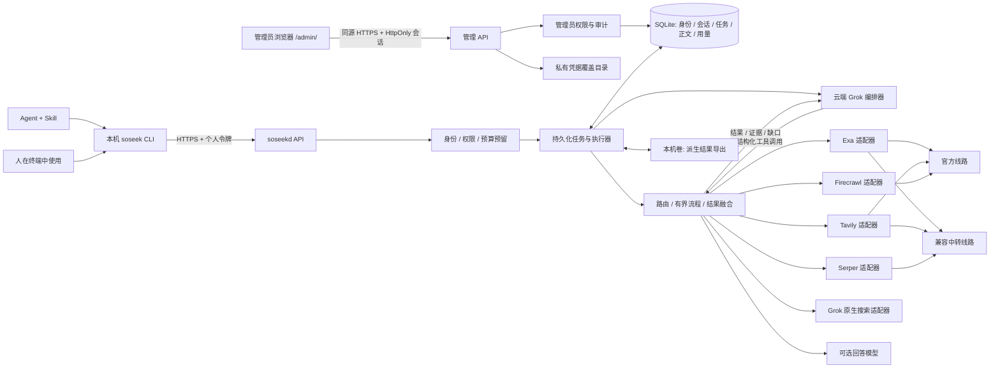

# soseek 设计基线

状态：首版实现的架构与行为约定；交付状态以 [实现记录](docs/IMPLEMENTATION.md) 和 [验收记录](docs/ACCEPTANCE.md) 为准。
更新：2026-10-17。
已确认的方向：云端中心；本机 CLI + Skill 调用云端；先供两名用户共用；开源供别人自部署。用户后续明确新增 shadcn/ui 管理面板，作为同源 HTTPS 管理入口；该扩展替代此前“仅本地管理命令、不提供 Web 管理”的边界。

云端 Grok 调用搜索/阅读工具并整合结果属于首版实现。固定流程末尾写答案与自主选择工具是不同路径，各自验收。

Grok 同时是 planner 和可单独调用或参与组合的搜索 provider。两条路径均已实现；第三方线路的实际协议与限额边界详见 [Grok 接入](docs/GROK.md)。

## 1. 产品目标

soseek 是面向 Agent 的搜索与网页阅读工具。用户可以完整使用一家服务的能力，也可以让多家服务并行搜索、融合结果，或分阶段搜索、读取、整理证据并生成回答。

成功的使用过程应该是：安装 CLI，配置服务地址和个人访问令牌，Agent 查询当前能力，然后按任务调用。新增上游、换 key、调整搜索策略都在云端完成，已经安装的客户端无需随之修改 Skill。

首版是一个私有的共享服务，不做公开注册、收费平台或租户市场。普通调用者不能自行添加上游密钥或渠道；管理员可在面板维护既有个人令牌、查看任务，并替换、停用或恢复部署中已有的上游凭据。开源用户可以部署自己的服务，也可以在自己的电脑运行同一服务；本机 CLI 首版不内置另一套直连上游的执行器。

产品要同时满足：

- 单独调用保留上游特色能力，不把各家都压成只有 title/url/snippet 的接口。
- 组合有明确用途、预算和来源；不默认为每个问题调用所有渠道。
- 搜索、阅读与生成回答可分开，获得资料不依赖额外配置一个语言模型。
- 提供可追溯的结果、实际调用记录和部分失败信息。
- 独立安装、自部署；jstarctl 只是本机部署和 Skill 分发的集成方式。

## 2. 总体架构

推荐用 Go 编写两个入口，共用协议类型与 SDK：`soseek` 客户端和 `soseekd` 服务端。选 Go 的主要依据是现有工具经验、HTTP 并发和单二进制交付；不是已经测得 Go 优于 Rust。这里主要等待上游，首版不做本地向量索引。



第一阶段只部署一个服务实例：一个 Go 进程，内置 API 和有界 worker 池，SQLite WAL 放在持久化的本地磁盘上。默认最多同时执行 2 个任务、每任务最多 3 个上游调用；实际约束还要取渠道、共享额度组和账号限制的最小值。

管理面板采用 React、TypeScript、Vite 和 shadcn/ui，构建 base 为 `/admin/`，产物由 Go embed 随 `soseekd` 提供；运行时不增加 Node 服务。管理权限与普通调用 API 分开校验：管理员会话能够访问全局管理视图，普通 `/v1` 请求仍受 principal 归属检查。

不引入 Redis、消息队列、Kubernetes、独立向量数据库或多个微服务。SQLite 方案不允许多个副本挂同一数据卷，也不放在共享网络文件系统。需要多机调度时再迁移 PostgreSQL 和独立 worker；那是后续迁移，不宣称首版天然支持。

本机只负责参数、认证、提交、等待、下载和展示。所有上游 key、路由规则、融合算法、缓存、预算、任务状态由云端持有。云端不可用时给出诊断：已经确认接受的任务展示 run ID；尚未确认提交的请求保留原幂等键，连接恢复后以相同请求重试。服务端尚未接受时不能编造任务 ID，也不悄悄转成本机直连。

## 3. 三个必须分开的概念

| 概念 | 示例 | 作用 |
|---|---|---|
| Provider：服务能力 | `exa`、`tavily`、`firecrawl`、`serper`、`grok` | 定义操作、参数和响应的含义 |
| Channel：接入线路 | `exa-direct`、`exa-proxy` | 绑定 provider、base URL、凭据引用和实际能力 |
| Credential / quota group：凭据与额度组 | 某个账号的一组 key、某个代理令牌 | 共享限速、余额、并发和冷却状态 |

同一个代理令牌可能同时服务三个 provider。必须给它们配置同一个 `quota_group`，否则三个适配器各自都以为有完整额度，会造成超发。

同一个 provider 的多个 channel 是替代线路，默认不同时参与融合。Exa 官方和经代理调用的 Exa 不是两家独立搜索引擎，不能为“多引擎一致性”重复加分。同一来源通过多条线路返回时合并 attribution，provider 投票最多一次。

key 池用于正常的可用性和配额管理。由管理员显式声明哪些 key 共用账号额度、哪些是独立额度；未知时保守处理，不用轮换同一账号的 key 绕过限流。

## 4. 调用方式与 CLI

首版命令如下；参数细节以 `soseek --help` 和 [CLI 指南](docs/USAGE.md) 为准。

```sh
# 首次配置：令牌交互输入或从 stdin 读，不放入 shell 历史。
soseek auth login --server https://search.example.org

# 日常搜索：使用部署配置的 generic 策略；结果解释实际选用了哪家。
soseek search "Go HTTP client timeout"

# 指定一家服务；不会失败后偷偷改用另一家 provider。
soseek search "vector search papers" --provider exa --opt exa.category="research paper"

# 只有显式指定线路时，线路才被固定。
soseek search "query" --provider exa --channel exa-direct

# 明确请求三家并行融合。
soseek search "query" --providers exa,tavily,serper --json

# 使用 Grok 自带的联网搜索，返回检索证据、引用及其综合文本。
soseek search "query" --provider grok --json

# 网页阅读；默认返回提取出的正文，不启动回答模型。
soseek read https://example.org/article --json

# 委托云端 Grok 拆题、选择工具、补查；默认交付证据包。
soseek research "某个技术问题" --profile deep --json

# 相同研究流程，交付带引用的综合回答和证据包。
soseek answer "某个技术问题" --profile deep --json

# 显式选择无 planner 的固定搜索/阅读流程。
soseek research "某个技术问题" --mode pipeline --profile deep --json

# 只看计划与预算边界，不调用任何上游。
soseek research "某个技术问题" --profile deep --plan --json

# 长任务和断线续取。
soseek research "某个技术问题" --detach --json
soseek runs get RUN_ID --json
soseek runs wait RUN_ID --json
soseek runs cancel RUN_ID

# 发现能力、线路和流程。
soseek providers --json
soseek profiles --json
soseek operations exa --json

# 标准 search/read 未覆盖的原生操作：仍经过云端预算与权限检查。
soseek call exa.find_similar --input request.json --json
```

`--provider` 和 `--providers` 互斥；显式列表默认 merge，不能与选择其他 provider 的 profile 混用。`--channel` 必须属于显式 provider。参数冲突在发送前报错，不能静默猜测。

`--opt` 使用 provider 命名空间，值按照操作的 JSON Schema 校验。普通字段有稳定的公共选项；特有字段只发送给对应 provider。未知参数明确报错并提示发现命令，不能显示成功却偷偷忽略。

`--intent` 是可选的任务类型提示，允许值从 discovery 读取，例如 general、news、papers。宿主 Agent 可在已经理解任务的前提下填写；不填时就是 general，不能声称服务器已理解用户全部意图。时间、地域、语言和域名约束是独立的硬条件；intent 不能替代它们。未配置某 intent 的路由时明确返回 unsupported_intent，不能悄悄当普通网页查询执行。

所有执行命令支持 `--budget-usd` 和服务端 `--deadline`，只能在管理员额度内收紧，不能放宽部署或身份上限。CLI 默认 compact；`--full` 返回完整存档，API 和持久化结果保持完整。`--max-chars`、`--fields` 控制返回体积，不改变实际检索和计费范围。`output_truncated` 标记 CLI 投影/裁剪，`source_content_truncated` 标记已存来源不完整；只有 CLI 省略的部分可由 `--full` 恢复。`runs source` 按 Unicode 码点分段读取已有正文或摘录，不发起新的抓取，不承诺恢复上游未返回或服务端未存下的内容。profile 声明适用 operation，search 不能选择会启动精读或模型生成的 profile；`deep` 只用于 research/answer。

`call` 是已注册原生操作的受控入口，不接受任意 URL、HTTP header、路径或方法，也不能覆盖认证、base URL 和预算。全新 provider 协议仍需要适配器代码；只有已实现协议的新增线路和能力声明可以仅改配置。

本机 `--json` 的 stdout 只输出一个最终 JSON 对象；JSON 和非 TTY 默认不输出常规进度，`--progress` 显式开启 stderr 进度。错误与恢复信息保留。`--stream` 独立输出 NDJSON 事件，不能与单对象 JSON 模式混用。compact 保留完整 answer、来源 ID/URL、query 关联、费用未知/预留状态和失败尝试；常规成功尝试及完整引用偏移留在 `--full`。终端输出清理来源中的 ANSI/控制字符。

退出码：0 = 成功或显式报告的部分成功，2 = 参数/输入问题，3 = 登录/权限问题，4 = 整体失败，5 = CLI 等待超时但云端任务仍在运行，6 = 已取消。`--require-all` 将部分成功转为非零退出。JSON 中的 `status`、warnings 和 attempts 才是完整状态，不能只看退出码。

Ctrl-C 默认停止本地等待，打印 run ID，云端任务继续；取消执行使用 `runs cancel`。本机等待时限与服务端执行 deadline 是不同参数，帮助必须讲清楚。

## 5. 云端流程

首版路由方式只实现 direct、fallback 和 merge。race 暂缓：取消慢请求不等于上游不收费，收益也需要实测。

| Profile | 行为 | 建议初始上限，均可由管理员修改 |
|---|---|---|
| `quick`（默认） | 使用对应 intent 的版本化单家优先策略；配置允许的明确可恢复失败才走备用路径 | 最多 2 次搜索尝试，8 条结果，20 秒总时限 |
| `broad` | Exa + Tavily + Serper 并行检索，融合结果 | 3 家，每家最多 8 条，合并最多 12 条，30 秒总时限 |
| `deep` | research/answer 默认由 Grok 有界编排；显式 `--mode pipeline` 则走固定的 broad → 选页 → 抓正文 | Agent：最多 6 轮模型决策、12 次上游工具调用、6 页正文、180 秒；pipeline：最多 6 页、120 秒；两者正文最多 60,000 字符，另受费用/token 上限约束 |

这些是产品起点，不是已经证明最优的路由。研究模式的设计默认是 `agent`：Grok 可以在原目标与硬约束内拆题和生成补充 query。显式 `pipeline` 只使用原查询或调用者提供的子查询，不自行扩展 query。两种模式都受同一个 run 总预算约束；子问题分别保留证据，不能只从所有结果的总榜取六篇而遗漏其他子问题。

Agent 的 12 次工具调用按实际发到上游的 attempt 计数，merge 一次访问三家就是三次，重试也计数；模型规划和最终写作另记模型调用及 token 成本。最终写作预留一次模型调用及其预算，不能研究耗尽全部额度后再隐式追加费用。具体 token 上限与价格必须随所选 Grok 线路配置并验证，未配置完整不能开放有硬预算的 agent 模式。

### 5.1 默认选谁，如何解释

首轮真实评测已完成 24 题：Exa、Tavily、两者融合共 72 次执行全部成功。22 道有期望域名的问题中，Exa 与融合均命中 22 道，Tavily 命中 18 道；这只是来源覆盖指标，不是事实正确率。当前 generic 保持 Exa 优先、Tavily 备用；Exa 的上游美元费用也能直接记录。Serper 已通过实际搜索，但发生过限流，本轮未继续比较。详见 [评测报告](evals/RESULTS.md)。运行时策略标为 `configured_priority`，任何自部署者都可以调整顺序；不能据此声称 Exa 普遍最优。

可执行的选择顺序：

1. 确认 operation。已给 URL 的 read 不需要先选搜索引擎；similar/news 等原生操作按对应 schema 处理。
2. 应用显式指定。指定 provider 不跨 provider 兜底，指定 channel 不换线路；显式 providers 列表才并行融合。
3. 没指定时，按请求 intent 查服务端的版本化策略。每项策略明确首选、备选、允许的降级条件和成本上限。不为路由单独付费调用模型，也不用少数关键词暗中猜测任务类型。
4. 过滤不满足 operation、输入参数、语言/地域/时间/域名硬约束、用户权限、费用上界、deadline 的候选。
5. 在剩余候选中按配置优先级选首家；渠道层再考虑冷却、额度和时限。健康信息只证明可运行性，不冒充结果质量评分。所有候选都不合格时，说明不可满足的约束，不能静默放宽。
6. 执行后保留选择理由。传输失败按既定政策处理；HTTP 200 但零结果不自动等于技术失败，也不触发隐式全家搜索。是否扩展查询由宿主或显式研究模式决定。

`plan` 和结果包含脱敏的 `routing`：policy/revision、intent 来源（调用者显式或 general 默认）、候选、排除原因、最终 provider/channel、fallback 原因、验证状态。不能只返回 `auto`。例如“general 联调策略优先 Exa；满足约束且未冷却；本次未启用备用服务”。

上线前用相同问题、相同过滤条件和相近采样时间比较候选；按日常网页、时效新闻、技术原始资料等任务分别看相关性、可阅读性、延迟和费用。调路由的问题与留作验收的问题分开；24 题只是首轮试测，不足以证明某家普遍最优。正式默认策略由这些结果和用户偏好决定，保留人工可配置的优先级，不做没有解释的自动学习路由。

### 5.2 谁决定下一步

| 执行方式 | 决策者 | 云端职责 | 当前设计状态 |
|---|---|---|---|
| 宿主 Agent 调工具 | 当前 Claude/Codex 等宿主，已有项目上下文 | 执行 search/read/native operation，回传来源、正文和缺口 | 首版基础路径 |
| 固定研究流程 | 版本化 pipeline 按规则执行 | 搜索 → 去重排序 → 有界选页 → 抓取 → 证据包；answer 可追加一次模型写作 | 首版显式 `--mode pipeline` 路径 |
| 委托云端研究 Agent | 云端 Grok 编排器 | 拆题、调用注册工具、检查资料、发现缺口后再查、决定停止 | 首版目标；research/answer 的设计默认 |

Skill 提供调用指导，CLI 负责传输，Go 调度器负责执行规则；研究模式中负责推理和决定下一步的是云端 Grok。planner 与最终写作是两个角色，可以使用同一已验证模型，但计费、提示和执行阶段分开记录。固定流程的写作步骤不能代替 planner 验收。

例如排查依赖升级问题：宿主从代码和报错中确定版本，调用 search 找官方变更，再 read 原文，发现遗漏后补查；云端不用重复理解整个代码仓库。对于“比较三个方案并调查反例”这类委托目标，若要一次提交后由云端持续研究，才需要第三种模式。

普通 search/read 不隐含启动 Grok；提交 research/answer 就是委托云端研究，也可显式写 `--mode agent`。planner 需验证结构化工具调用与失败恢复，不能仅因兼容聊天接口就认定可用。planner 只提出操作、参数、所解决的子问题和简短的动作理由/停止理由；执行器仍验证权限、Schema、SSRF、预算、总调用次数、轮数与 deadline，模型不能放宽这些限制。

首版 Agent 循环：

1. 接收目标、可选上下文、硬约束和预算；只给 Grok 当前身份可用的操作 schema、能力声明和验证状态，不给凭据或内部网络地址。
2. Grok 拆分子问题，选择服务或多家组合、query、过滤条件与工具参数。具体 channel/key 始终由执行器按策略选择，Grok 不调度密钥。
3. 执行器校验并持久化动作，调用适配器；URL 去重、RRF、缓存和费用结算仍是确定性代码，不交给模型凭文字模拟。
4. Grok 读取带来源编号的结果，决定哪些网页需要正文、缺少什么、是否换服务或改写 query；上游正文只作为证据，不可变更工具权限和任务规则。
5. 每轮保存结构化子问题/证据/缺口状态和工具调用 ID。恢复时复用已完成的动作，不因重新请求模型就重复执行；未决上游步骤继续遵循 uncertain 语义。
6. 完成或触发上限时，返回证据包、未解决项和停止原因；answer 在预留预算内生成引用回答。预算或模型故障导致未完成时保留已有结果并标 partial，不伪称研究完成。

工具集中包含 `grok.search`：planner 可选择 Grok 自带搜索，也可调用 Exa/Tavily/Firecrawl/Serper，或在预算内组合。首个实现采用独立、可追踪的原生搜索步骤：该步骤只开放受限的上游内置搜索工具，不开放 planner 自身或任意自定义工具，避免递归委托。编排步骤与原生搜索步骤可以使用同一模型和线路，但各自记录消息、调用 ID 与用量。

该模式要维护子问题—证据对应表；结束时返回已覆盖项、未解决项、冲突及停止原因（目标完成、预算/时间耗尽、连续无新证据或失败）。是否充分支持仍是可质疑判断。宿主将一次云端研究视为委托，等待它交回结果后再决策，避免双方同时为同一问题重复搜。固定流程始终作为不依赖 planner 的可用路径。

`answer` 与 `research` 共享同一研究执行器，在证据包后加 synthesize 阶段。planner 阶段可以提出注册工具调用，由执行器批准并执行；synthesize 阶段只写作，不再调用工具。两个阶段都不持有上游凭据，网页正文均视为资料。

Grok 是首版编排目标，并作为原生搜索 provider 接入；这两项能力分别声明和验收。现有 Grok CLI 和 imagen 的 Grok 图像渠道提供可复用的 endpoint 与认证配置。soseek 直接调用对应 API，不要求云端启动本机 CLI 或把图像模型当作搜索模型。其他模型可作为配置扩展，不用替代模型成功冒充 Grok 验收成功。

指定线路已接入 `/chat/completions` function calling 和 `/responses` 原生 Web Search，两者通过独立 adapter 执行；当前实测及剩余边界见 [Grok 记录](docs/GROK.md)。Grok 模式不可用时不能自动降级为 pipeline 并声称完成原研究任务，用户仍可明确选择固定流程。上游原生调用可能不遵守请求上限；实际超限时标记 partial、记录计数并停止后续请求。

每个 run 固定保存：profile revision、路由配置 revision、参数、预算、provider/channel、适配器版本、融合版本、模型标识与提示版本。配置更新不改变已经接收的任务。显式指定 provider 的调用只允许在该 provider 的线路中兜底；显式 channel 则不替换线路。

## 6. 结果与融合

公共搜索结果至少包括 `source_id`、`url`、`canonical_url`、`title`、`snippet`、可用的发布时间、抓取时间、`found_by`、各 provider/query 原始 rank、融合分数及 score components。缺少的字段是 null 或明确缺失，不伪造发布时间和可信度。每次出现保留 occurrence（provider、channel、query_id、rank、获取时间）；合并只改变呈现，不删除发现记录。

URL 规范化只做保守规则：规范化 scheme/host/default port，移除已知跟踪参数。保留影响内容的查询参数；不能普遍删除所有 query 或 fragment，也不假定 http/https、www/裸域、尾斜线均等价。`?id=1` 和 `?id=2` 是不同资源，`?utm_source=x` 这类跟踪差异可以消除。重定向终点、canonical tag 只在实际读取后记录，并按可信规则使用；跨域 canonical 标签本身不足以合并。

同 canonical URL 合并为一条结果，多份标题/摘要作为带来源的 variants 保存，不拼接成来源不明的新摘要。标题相同但 URL 不同不能直接去重。

首版全文读取后可对规范化正文作 exact hash 去重；重复页在展示中折叠、保留原 URL、引用和版本。同站页面改版的新正文保留新版本。跨站转载是多个发现入口而未必是独立证据。近重复、语义聚类与 MMR 暂作为后续评测选项，首版不能靠相似标题把“赞成”和“反对”的不同页面合并。

第一版采用带权 RRF，默认权重相等、`k=60`，作为可解释基线：`score = sum(weight(provider)/(k+rank))`。某 provider 没找到该 URL 时贡献 0；不把它按列表末尾参与计分。原始上游分数保留但不直接混加，因为各家分数含义和尺度不相同。

例如 Exa 返回 `[A, B]`，Tavily 返回 `[B, C]`：A 分数 `1/61≈0.01639`，B 分数 `1/62+1/61≈0.03252`，C 分数 `1/62≈0.01613`，输出 B、A、C。B 因多个列表都把它排在前面而靠前，不因此被标成事实已核实。

每家 provider 在一个子问题的融合中对 URL 贡献最多一次。同一子问题的多个查询改写先按 provider 合并，取最佳 rank；同一 provider 的多线路也不增加票数。记录每家实际查询数量，评测时给各家同等改写预算。不同子问题分别融合、保留各自 top 候选，再做全局 URL 去重并分配阅读名额，不能把所有子问题和改写当成互相独立的票。

按融合分数排序，同分先比较最佳原始名次，再按 canonical URL 确定稳定顺序。provider 的固定权重、查询分组方式和候选截断数都保存版本。不同 provider 也可能使用同一索引；未知的底层依赖不擅自推断，但 `found_by` 始终只表示发现来源数，不表示独立证据数。

Grok 搜索可能返回检索事件、来源、综合文本和引用，而不是同格式的 SERP 排名。保留其原始检索事件；如果没有可信的原始 rank，记为 null，不能把模型引用顺序冒充搜索排名参与 RRF。组合结果先融合有 rank 的列表，再把 Grok 新来源作为标注独有来源的 evidence supplement 展示/选读，单家 Grok 保留自身综合文本和引用；source 去重统一执行。后续可以评测统一 reranker，但不能凭空编造 rank 或把模型文本当成网页原文。

按融合排名输出，并默认最多每个可注册域名 2 条；单域搜索或显式 include-domains 场景可调整该限制。使用 Public Suffix List 识别可注册域，不能简单截最后两段。对候选不足保留少量结果并说明原因，不偷偷解除硬约束。首版不直接叠加没有验证依据的“权威分”和“新鲜度分”。日期过滤和来源类型作为显式约束；“几家都找到了”不等于事实正确。

精读阶段按排序和域名多样性选择网页，记录失败、截断、抓取时间及正文内容 hash。摘要不能被标成已读取全文，预算不足造成的少读不能被隐藏。

回答使用稳定的 `[S1]` 来源编号，并给出 URL 与相应证据片段。机械校验引用编号存在、被引内容来自本次证据；不能声称机械校验已经证明语义支持。缺乏来源时报告证据不足；不把模型先验生成的文段冒充检索发现。

`raw` 上游响应按需提供、脱敏且受大小限制；公共结果里有到 raw artifact 的引用。保存原生特色字段，但不把巨量 raw 默认塞给 Agent。

建议结果信封：

```json
{
  "schema_version": "1.0",
  "run_id": "run_example",
  "status": "partial",
  "operation": "search",
  "results": [],
  "attempts": [
    {"provider": "exa", "channel": "exa-direct", "status": "succeeded"},
    {"provider": "tavily", "channel": "tavily-direct", "status": "failed", "error_code": "upstream_timeout"}
  ],
  "usage": {"reported_usd": "0.007000", "estimated_usd": null, "unsettled_attempts": 1},
  "warnings": ["One upstream timed out; its charge is not yet known."],
  "truncated": false
}
```

金额用 decimal 字符串或整数微美元存储，不用浮点数记账。上述空 results 只是 schema 示例，真实 partial 搜索必须至少有可交付结果。

## 7. API、持久化与恢复

| API | 作用 |
|---|---|
| `GET /v1/capabilities` | API/Schema 版本、可调用操作、参数 schema、profile revision、限制、可用性 |
| `POST /v1/plans` | 校验请求并产生不访问上游的计划、额度单位与费用上下界 |
| `POST /v1/runs` | 持久化接受任务，返回 202 和 run ID；要求 `Idempotency-Key` |
| `GET /v1/runs/{id}` | 状态、进度、warnings、结果摘要 |
| `GET /v1/runs/{id}/result` | 完整或按字段/长度裁剪后的结构化结果 |
| `GET /v1/runs/{id}/events` | SSE 进度；支持 `Last-Event-ID` 断线恢复 |
| `POST /v1/runs/{id}/cancel` | 幂等请求取消；允许结果为 cancelled 或已先完成 |
| `GET /v1/artifacts/{id}` | 带鉴权的正文/原生结果下载 |
| `GET /v1/usage` | 当前身份的使用量、估算、未知费用与额度 |

所有操作最终进入同一个 run 协议，避免 search/read/research 各有一套异步语义。JSON 结果支持 additive schema 演进；破坏性变化升级 API major version。客户端按 required fields 和未知字段兼容规则解析。

状态：`queued → running → succeeded | partial | failed | cancelled`。步骤另有 `pending / in_flight / succeeded / failed / uncertain / cancelled`。总 deadline 到期必须进入终态，不能无限 running；有结果且允许降级时 partial，否则 failed。模型阶段失败时保留证据包，answer 结果明确标 partial。

HTTP 202 只能在任务与幂等记录事务提交后返回。CLI 在提交前把幂等键、规范化请求和参数摘要原子写入私有 pending 状态；提交响应丢失后用同一个键和原始请求重试，不能生成新键。收到 run ID 后删除本地请求正文，仅保留 ID/服务地址；未提交的本地正文最长保留 24 小时，过期清理后不能自行重建或重发。相同键但请求摘要不同返回 409。幂等键按身份隔离，终态后保留 7 天；超出窗口后不保证去重。

服务进程重启后恢复排队步骤和已完成结果。发送前记录上游 attempt，并区分尚未发出、已发出但结果未知、已经收到响应；结果丢失时不能宣称端到端 exactly-once。首版单实例 worker 用数据库事务领取步骤并保存执行代次，拒绝过时代次写回。

不确定是否已计费的步骤标记 uncertain、保留预算预留，不自动重放同一请求。只有上游支持幂等查询/任务查询才能自动对账恢复；否则在返回结果中显示边界，用户可显式重试并接受潜在重复费用。预先获准的其他 provider 步骤仍可在剩余预算内执行。

SSE 事件也持久化，只有进度和结果引用，不含凭据或正文。过期游标返回明确恢复方式，客户端读取当前快照；不依赖事件流才能取得最终结果。取消会阻止后续步骤并尽力中断已发请求，但不承诺退还上游费用。

## 8. 身份、数据和费用

两人共享一个部署和管理员配置，但各自持有命名访问令牌。每个令牌绑定 principal、允许操作、每日费用限额、速率和并发上限；服务端只存访问令牌的强随机值 hash，明文只在发放时出现。

客户端连接配置与凭据分开，优先用系统凭据存储；无桌面凭据库的环境允许只读 secret 文件或环境注入，文件权限限制为当前用户。退出登录删除本机凭据；服务端吊销是独立的管理员动作。吊销令牌立即阻止新提交并请求取消尚未完成的任务，已经发出的上游调用不保证可撤回或退款。

首版角色只有 admin 和 caller。用户已明确新增管理面板：`/admin/` 与 `/admin/api` 通过同一 HTTPS origin 提供，管理员可管理个人令牌、查看全体任务和用量、取消任务、维护既有上游凭据及查看审计。既有令牌不会自动获得管理员权限；只能在服务器上执行 `soseekd admin grant --config FILE --id PRINCIPAL_ID` 完成授权，网页创建的身份默认都是 caller。CLI 普通用户只能看自己被允许使用的能力和线路别名，看不到上游地址中的私密信息、key 指纹或他人的用量明细。

登录以有效管理员令牌交换 12 小时会话，浏览器使用 HttpOnly、SameSite=Strict Cookie，HTTPS 下启用 Secure；不将访问令牌存入 localStorage、sessionStorage 或 URL。管理写操作要求准确的同源 Origin 和非简单请求头，不开放 CORS。退出面板注销该会话；轮换或吊销身份令牌使其既有管理会话失效。反代 HTTPS 状态只接受回环来源或 `trusted_proxies` 明确列出的来源；容器网关/反代容器应配置实际精确 IP CIDR，不可默认信任整个网络。

任务、结果、artifact、幂等记录和内容缓存默认按 principal 隔离。知道 run ID 不是访问授权，普通调用者不能互相读查询或结果。管理员通过独立管理会话可以查看全体任务和正文，这是已授权的管理权限，不改变普通 `/v1` 路径的归属检查。首版不做跨用户内容缓存或普通用户间的任务共享。

云端读取上游 secret 文件或受部署环境提供的 secret 引用；仓库配置只放引用和示例。这里不用数据库加密存储再发明一套主密钥分发。服务器数据卷及备份必须受权限保护，密钥不进入普通数据库备份和日志。用户的服务登录密码/TOTP 不需要部署到云端，只部署 API key。

管理员在面板中只能替换、停用或恢复既有 credential 引用，不能新增 provider/channel、改变 endpoint、模型和能力配置。共用同一引用的渠道共同受影响。覆盖与停用标记保存在 `dirname(database)/credentials`，目录 0700、文件 0600；停用不能回退到原 key，恢复部署配置则移除覆盖并重新读取原引用。原 secret 文件无需可写。列表和审计只返回状态与引用标识，不返回密钥明文或后缀。该目录与 SQLite 快照独立，发布、回滚及备份恢复均需明确保留和保护。

调度前在数据库事务中预留费用、渠道配额及并发；约束取 run、principal 日预算、部署日预算、provider/credential/quota-group 配额的交集。每个真实 attempt 都记账，包括失败、取消和重试，不能只记录最后成功的一次。

记录三层事实：上游报告的 USD 或 credits、根据价格版本估算的 USD、尚未确定的费用。credits 不直接与美元相加；缺少换算规则时保留原单位。

Grok 原生搜索记录模型 token、服务端工具调用数量和引用/检索事件。本次 Responses 路径返回 `cost_in_usd_ticks`，按官方定义 10^10 ticks = 1 USD；这只作为上游报告费用，不能直接等同于第三方代理最终账单。本次 Chat Completions 路径只返回 token 用量，未见该费用字段，必须分别标记，不填 0。soseek 的同额度组预算也不能假定掌握其他 CLI/imagen 的并发消耗，需要额度观测与保守余量。

硬预算只对可确定的费用上界生效：没有可靠上界的操作不进入硬限额流程，计划返回 `cost_bound_unavailable`，而不是伪造精确报价。首版 deep 只使用有已知上限的搜索、阅读操作；模型生成限制输入/输出 token 和调用次数。支持的上界还必须考虑最低计费、抓取附加项和潜在 uncertain 调用。

收到 401 时隔离该 credential；403 区分权限与内容拒绝；402 标为配额不足。429 遵守 Retry-After，冷却真正的 quota group，不立刻换同组 key 重试。无响应的网络超时按 uncertain 处理；明确非计费、可重试的失败才在有限总尝试次数内重试。请求参数错误不换渠道重试。

内容缓存键包括 principal、查询/URL、操作、参数、过滤条件、provider/channel 能力版本和 profile revision。默认搜索缓存 5 分钟、正文缓存 1 小时；新闻/实时查询可跳过。`--fresh` 明确跳过缓存。`cached=true`、原获取时间和来源可见；命中缓存不记成新上游费用。

不做无限期查询档案：建议任务输入、结果和原生 artifact 7 天后删除，正文缓存按 TTL 清除；用量账本保留 90 天且只留身份 ID、用量、状态、时延等，不留查询或正文。run/result/artifact 过期后返回 410。期限由管理员配置，幂等保留窗口内不得因为删除结果而重新执行旧请求。

预算按部署约定的 UTC 日窗口记账，跨日运行归属接受任务时的窗口；未结算的预留不能因为午夜重置而释放，且继续占用部署总风险额度，直到对账或管理员按最坏上界结算。运行数据删除与备份到期分开说明；备份建议保留 7 天，恢复后执行过期清理，不宣称删除即时覆盖已有备份。

网页读取默认只允许公网 HTTP(S)，禁止 localhost、私网、链路本地、云 metadata、内嵌账号密码，并检查重定向与 DNS 解析。跨域重定向不携带认证信息；服务器的出站策略作为第二道约束。上游代抓时本地检查无法完全控制其 DNS，因此不接受任意网络目标或私网抓取功能。

## 9. 能力发现和 Skill

`capabilities` 分开表达：

- **Implemented**：适配器实现的操作、输入 schema 和公共输出语义。
- **Declared**：某条线路配置声明支持的能力、限制、价格与额度组。
- **Verified**：最近真实验证过什么、时间和验证层级（认证、搜索、正文、生成）。
- **Available**：当前身份是否被允许使用，以及线路健康、冷却和额度状态。

`unknown` 不等于不支持，也不等于已验证支持。未实现的 operation 不可调用；已实现但尚未验证的线路可以按管理员策略开放，并在结果里保留验证状态。未声明的特有参数通过 schema 和显式扩展入口处理，不能悄悄丢弃，也不把声明等同于上游事实。

Skill 是调用指南：先发现能力、按任务提供 intent/硬约束或指定 provider、使用 JSON、处理 partial、按需取正文和引用、交付实际结果。它不嵌入具体渠道清单、模型名、价格和实时额度，也不默认让每次简单查询重新查询全部能力。

CLI 缓存 discovery 并通过 ETag/revision 更新；缓存有效期建议 5 分钟。每个服务响应携带配置 revision；若操作被移除、权限变化或 schema 冲突，刷新一次并重新校验，不能悄悄改写用户意图。宿主 Agent 可以根据结果决定下一次调用；Skill 不复制云端的路由、融合和 key 调度算法。

仓库提供一个 canonical Skill，客户端通用安装使用仓库发布物；本机 jstarctl 同步该来源。首版不要求客户端安装 MCP，Searchix 的 MCP 工具列表仅是已做过的认证/能力发现证据，真正运行路径采用 REST 适配器。

## 10. 首版适配范围

| Provider | 第一条可验收路径 | 后续首版扩展 |
|---|---|---|
| Exa | search、contents/read；官方与兼容代理 channel | find_similar、provider-native answer（与 soseek answer 分开命名） |
| Tavily | search、extract/read；官方与兼容代理 channel | map、crawl；长任务接入统一 run 生命周期 |
| Firecrawl | scrape/read、search；官方 channel | map、crawl；限制深度、页面数与费用 |
| Serper | web search；当前通过兼容代理 channel | news、scholar、images，保留原生字段 |
| Grok 原生搜索 | Responses API 的 web_search，保留调用事件、来源和引用 | X Search、图像理解等单独探测后再声明；不因 Web Search 可用就自动开启 |
| 云端 Grok 编排 | 结构化工具调用、多轮选择原生/外部搜索与阅读、缺口补查与停止 | 带引用的综合回答、失败恢复、费用与轮数限制；必须验证指定 Grok 线路 |

每个操作只有在实现、参数映射和测试齐全后才出现在 discovery；不能用一个通用 HTTP 代理声称已完整适配全部 API。采购的账号额度不是程序常量，以当时上游响应为准。

## 11. 部署和管理

发行独立的客户端与服务端二进制、服务端 OCI 镜像和最小自部署说明。参考部署是单机持久化卷 + HTTPS 反向代理。进程可由容器或 systemd 管理，同一台机器只选一种；SQLite 的可靠备份使用在线备份接口，不直接复制正在写的主文件。

正式构建先执行 `scripts/build-web.sh`：使用固定 pnpm 版本冻结安装前端依赖、构建 `/admin/` 资源并同步至 `internal/adminui/dist`，再编译 Go。release 脚本和 CI 必须执行此前置步骤；Docker 使用 Node 构建阶段，再复制前端产物到 Go 阶段，最终镜像不含 Node。生成资源不入 Git，保留 `placeholder.txt` 供普通 Go 测试/构建；只有占位文件的服务在管理入口返回 503 构建提示，不能作为含管理面板的发行物。

健康接口拆为 liveness、readiness 和需要鉴权的诊断。readiness 检查配置、数据库迁移、存储可写，不轮询付费上游。provider probe 只能显式执行，并报告成本与验证层级。

升级先验证配置、备份数据库、保留私有凭据覆盖目录、执行迁移再启动；破坏性迁移不能假定旧二进制可以直接回滚。SQLite 快照包含身份、管理员授权、会话、任务及审计，不包含上游 key；完整恢复需另外恢复配置、原始 secret 与覆盖目录，并核对快照后的吊销/权限变更。私有部署通过已有 jstarctl source-of-truth 流程配置域名、服务、secrets 引用和备份，不在运行目录里做不可重建的手工修改。管理面板的运行时 secret 覆盖是明确持久化的独立状态，不能被后续部署悄悄清除。

具体主机、域名、令牌分发方式和备份目的地在部署阶段根据实际环境确定。本设计不假定已购买域名、拥有高可用设施或有任何生产变更授权。首版是单机服务，依靠可恢复性，不宣称跨区域高可用。

## 12. 验收和设计边界

必须在真实的本机 CLI → HTTPS 云端 → 指定渠道路径验收，不能以云端 curl、本地 mock、模型列表或认证通过代替。

- 单家调用：服务和显式线路保持一致；特有参数生效或明确报错。
- 融合：多个 provider 的来源和 rank 可追溯，同 provider 的两条线路不重复投票；一家失败保留其余结果。
- 精读：至少一条真实搜索→抓取→证据流程；正文、URL、时间与截断说明一致。
- 回答：一个已验证模型完成带引用回答，并人工检查引用是否支持关键结论。
- Grok 编排：从 research/answer 的真实 CLI 路径，由指定 Grok 模型实际选择并调用搜索/阅读工具；覆盖一次发现缺口后的补查或有依据的结束、约束不能被模型放宽、达到上限停止、重复工具调用不重放和模型失败保留证据。不能用固定脚本预选动作、仅一次最终写作或其他模型替代这项验收。
- 成本：并发预留防止超发，成功/失败/取消/unknown 都记账；无上界操作无法绕过硬预算。
- 恢复：客户端断线后取回同一个任务；丢失提交响应不重复创建；服务重启不盲目重放 uncertain 步骤。
- 隔离：两名普通用户不能互读任务、正文、缓存和用量；令牌吊销生效。管理员的跨用户管理视图必须使用有效管理会话，不能通过普通 Bearer API 绕过归属检查。
- 管理面板：真实浏览器验证 HTTPS/同源登录与退出、12 小时会话、caller 拒绝、令牌创建/轮换/吊销/配额、全局任务查看、既有凭据替换/停用/恢复与审计；重启和升级不丢覆盖文件，SQLite 备份不含上游 secret。前端打包成功不能替代这些验收。
- 安装：干净环境仅需 CLI、云地址和访问令牌；无需安装 jstarctl 或上游 SDK。
- 自部署：按文档新建空实例、配置自己的 key、运行首个查询并完成备份恢复。

用固定的至少 24 个问题做首轮评测，覆盖事实查询、时效信息、技术资料、小众主题、中文与英文。比较单家与组合的有效来源覆盖、重复率、可核实性、延迟、实际/估算费用和阅读成功率。人工盲评相关性和答案引用；没有可靠真值时不标注“准确率提升”。

性能目标先记录 cold/warm P50/P95 与本地处理耗时，明确上游和网络的占比；不预先承诺“比某家快”或“融合一定更好”。若组合没有带来可解释收益，调整 profile 或保留单家默认，而非用更多渠道掩盖问题。

更多输入形态、决策归属与阶段划分见 [场景设计](docs/SCENARIOS.md)。场景清单用于检验接口能否组合，不意味着全部纳入首版。
