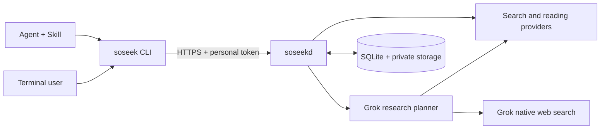

# soseek

[Source](https://github.com/samekind/soseek) · [Releases](https://github.com/samekind/soseek/releases)

Search, read, and research from your terminal—with one provider, several providers,
or a cloud Grok agent that decides what to look up next.

soseek has two Go binaries:

- **`soseek`** is a thin CLI for people and coding agents. It authenticates to your
  server, submits work, follows progress, and retrieves results.
- **`soseekd`** runs the work. It holds upstream credentials, routes requests,
  combines search results, reads pages, and runs a bounded Grok tool-calling loop.

The initial deployment model is a private shared service with a separate access
token per user. Other users can self-host the same server. The client does not
need upstream API keys, provider SDKs, or jstarctl.



## What it does

- **Use a provider directly.** Explicit provider and channel selection stays
  explicit. Provider-specific options and registered native operations remain
  available through discovery.
- **Combine search sources.** Parallel requests retain source attribution and
  individual attempts. URL deduplication and rank fusion do not count two
  channels for the same provider as two independent search engines.
- **Read pages separately.** Fetch a page without starting an answer model.
- **Delegate research to Grok.** The cloud model can select searches, read pages,
  follow missing evidence, and stop within server-enforced limits. Grok also
  exposes its own native web search as a search provider.
- **Recover accepted work.** Runs have persistent IDs; leaving the terminal does
  not cancel them. A lost submission response can be resumed with the original
  request and idempotency key.
- **See the boundaries.** Results include attempts, warnings, sources, and usage.
  Partial results and unresolved charges remain visible.

Provider adapters cover Exa, Tavily, Firecrawl, Serper, and Grok. The actual
operations, configured channels, limits, and verification status depend on your
deployment. Query the running server; this README is not a live capability list.
Grok requires a compatible endpoint with the relevant search and tool-calling
protocols. A working chat endpoint alone does not establish those capabilities.

## Build and connect

Use **Go 1.27.1 or newer** to build from a source checkout:

```sh
go build -trimpath -o ./bin/soseek ./cmd/soseek
go build -trimpath -o ./bin/soseekd ./cmd/soseekd

mkdir -p "$HOME/.local/bin"
install -m 0755 ./bin/soseek "$HOME/.local/bin/soseek"
```

Ensure `$HOME/.local/bin` is on `PATH`, or use `./bin/soseek` directly. Source
builds are available now. Prebuilt archives are available from the organization's
[releases](https://github.com/samekind/soseek/releases) through
[the release installer](scripts/install.sh).
The installer downloads an existing release and verifies its checksum; it does
not build from source or create an account.

Ask your server administrator for an individual **soseek access token**, then
log in. Interactive token entry is hidden:

```sh
soseek auth login --server https://soseek.example.com
soseek doctor --json
soseek capabilities --json
```

For automation, use `--token-file /private/path/token` or `--token-stdin`. Token
files must be private (`0600` on Unix). Do not put tokens directly in command
arguments. The CLI stores its server configuration and token separately; it
does not store your upstream provider keys.

Remote servers require HTTPS. HTTP is accepted only for `localhost` or a literal
loopback IP, for example `http://127.0.0.1:8080` when testing a local server.

## Use it

Inspect a plan without calling any paid upstream API, then run the query:

```sh
soseek search "Go HTTP client timeout" --plan --json
soseek search "Go HTTP client timeout" --json
soseek read https://go.dev/doc/ --json
```

Select providers when they are available on your server:

```sh
soseek providers --json
soseek operations exa --json
soseek search "vector search papers" --provider exa --json
soseek search "SQLite write concurrency" --providers exa,tavily --json
soseek search "recent Go releases" --provider grok --json
```

Delegate a bounded investigation to the cloud Grok planner:

```sh
soseek research "Compare SQLite and PostgreSQL for a small job service" \
  --budget-usd 0.50 --deadline 180s --json

soseek answer "What failure modes should a small job service test?" \
  --budget-usd 0.50 --deadline 180s --json
```

`research` returns the gathered evidence; `answer` also requests a synthesized
answer with source references. Both use cloud agent mode by default. Use
`--mode pipeline` to select the fixed search/read workflow. Budgets and deadlines
can only tighten administrator limits. The shown budget is an example, not a
price quote or a guarantee that a particular deployment can complete the task.

For long tasks:

```sh
soseek research "Investigate a technical question" --detach --json
soseek runs wait RUN_ID --json
soseek runs get RUN_ID --json
soseek runs cancel RUN_ID
```

`--json` writes exactly one final JSON object to stdout. Progress goes to stderr.
`--stream` instead writes NDJSON events and a final result, using the server's SSE
event stream. The modes are mutually exclusive. Ctrl-C stops local waiting;
`runs cancel` explicitly requests server-side cancellation.

See [CLI usage](docs/USAGE.md) for native operations, output selection, recovery,
configuration paths, and exit codes.

## Costs, evidence, and recovery

Usage keeps **upstream-reported**, **estimated**, and **reserved** micro-USD
amounts separate. One USD is 1,000,000 micro-USD. Provider credits are a separate
unit. `unsettled_attempts` means the final charge for those requests is unknown;
an empty or zero reported amount is not proof that no charge occurred.

Server budgets depend on administrator-declared operation ceilings. Review them
against the actual provider and proxy contract. They are not a replacement for
the provider's billing records, and the server cannot account for unrelated
clients using the same upstream account.

Sources keep their discovery attribution. A search snippet, a fetched page, and
a model summary are different kinds of evidence. Several engines returning the
same page does not verify that page's claims. Generated citations still need
review for semantic support.

Before submitting work, the CLI saves a private pending record. If the response
is lost, follow the reported `pending resume` command: it reuses the original
request and key. Accepted records retain the run ID and remove the local query
body. Unacknowledged request bodies expire after 24 hours and are removed during
pending cleanup. Do not issue a fresh search as a substitute for recovering an
ambiguous submission unless you intend to create another run.

Server recovery preserves uncertain upstream attempts instead of blindly
replaying potentially billed work. Cancellation stops later steps and attempts
to interrupt active requests; it cannot guarantee a refund.

## Self-hosting

Follow [the deployment guide](deploy/README.md) for the container, native systemd
service, HTTPS proxy, token administration, and backup/restore procedure.
[The example configuration](deploy/config.example.json) contains placeholders;
replace them with your own endpoints, secret references, capabilities, and cost
ceilings before use.

The server uses **one instance, a bounded worker pool, and SQLite on a persistent
local disk**. Do not share the database over NFS or run multiple executors against
the same file. This version does not provide multi-node scheduling or database
high availability. Users share configured upstream capacity, while task access
and content caches are scoped to their identities.

Administration is local through `soseekd admin`; there is no public account
registration, billing portal, or web administration interface. The CLI can
connect to a local development server or an independently deployed cloud
instance using the same protocol.

## Development

```sh
go test ./...
go test -race ./...
go vet ./...
```

Tests use local fixtures for protocol and failure behavior. They do not establish
the search quality or billing behavior of a live provider. Real acceptance must
exercise CLI → HTTPS server → the configured provider, including the intended
Grok model for research.

`scripts/release.sh 0.1.0` builds macOS/Linux/Windows clients for arm64 and amd64,
Linux server binaries, archives, and checksums. It does not publish them.

Architecture and remaining design boundaries are described in [DESIGN.md](DESIGN.md),
[scenarios](docs/SCENARIOS.md), and [Grok integration](docs/GROK.md).
See [live acceptance](docs/ACCEPTANCE.md), [the first 24-question baseline](evals/RESULTS.md),
and [the backup restore check](docs/BACKUP-ACCEPTANCE.md) for the observed results
and their limits. Successful retrieval does not establish answer accuracy.

## License

[MIT](LICENSE).
